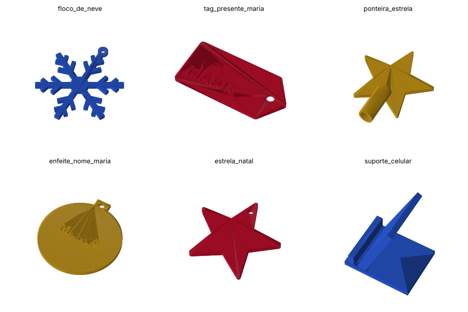

# Plano de Natal 2026 (Uberlândia)

## Linha de produtos
| Produto | Arquivo | Cor | Custo | Preço |
|---|---|---|---|---|
| ⭐ Enfeite com nome | `enfeite_nome_*.stl` | dourado (nome vermelho) | R$ 1,20 | R$ 12 / 3 por R$ 30 |
| 🎁 Tag de presente "PARA: nome" | `tag_presente_*.stl` | vermelho ou dourado | R$ 0,50 | R$ 5 / 6 por R$ 25 |
| ❄️ Floco de neve | `floco_de_neve.stl` | azul | R$ 0,50 | R$ 5 / 6 por R$ 25 |
| ⭐ Estrela pequena | `estrela_natal.stl` | vermelho ou dourado | R$ 0,90 | R$ 6 / 5 por R$ 25 |
| 🌟 Ponteira de árvore (12 cm) | `ponteira_estrela.stl` | dourado | R$ 4 | R$ 35 |

**Combo que mais vende: "Kit Família"**: 4 enfeites com nome + 1 ponteira por **R$ 69**. Custa uns R$ 9 para fazer.

**Uso do filamento:** dourado (600 g) só para enfeites com nome e ponteiras, porque é o que dá mais dinheiro por grama. Vermelho e azul (PETG) para tags, estrelas e flocos.

## Fatiamento
Use as mesmas configurações do `GUIA.md`, com estes ajustes:
- **Tag, floco e estrela:** peças finas. Encha a mesa (15 a 20 por vez) e use 100% de preenchimento, porque já são finas.
- **Ponteira:** imprima deitada, como vem no arquivo. Use **suporte: ligado, só na base ("touching buildplate")**, por causa do tubo redondo.
- **Enfeite e tag com nome em outra cor:** pause e troque o filamento na camada logo depois da base (enfeite: 3,0 mm; tag: 2,0 mm).

## Calendário
| Quando | O que fazer |
|---|---|
| **Esta semana (até 21/11)** | Imprimir amostras: 3 enfeites com nomes da família, 1 ponteira, 6 flocos e 6 tags. Fotografar numa árvore ou galho. |
| **22/11 – 30/11** | Postar todo dia no Marketplace, em 3 a 5 grupos de Uberlândia e no status do WhatsApp. Oferecer para **escolas e empresas** (lembrancinha de fim de ano em quantidade). |
| **1/12 – 15/12** | Pico de pedidos. Imprimir à noite, de mesa cheia. Avisar: "pedidos até 18/12". |
| **16/12 – 20/12** | Último prazo. Postar "ÚLTIMOS DIAS". Amigo secreto: tags e chaveiros. |
| **Depois de 20/12** | Parar de aceitar personalizados, porque não dá tempo. Vender só o que tiver pronto. |

**Capacidade:** a impressora faz uns 10 enfeites por mesa (~4 a 5 h). Rodando 2 mesas por dia dá **~20 enfeites/dia**, e o dourado acaba em ~3 dias. Antes disso, compre mais dourado com o lucro.

## Anúncios de Natal
**1. Kit Família**
> 🎄 SUA ÁRVORE COM O NOME DE CADA UM DA FAMÍLIA 🎄
> Enfeites dourados personalizados, feitos aqui em Uberlândia em impressão 3D.
> 🌟 KIT FAMÍLIA: 4 enfeites com nome + estrela de ponta de árvore: R$ 69
> ✨ Avulso: R$ 12 cada | 3 por R$ 30
> 📦 Pronto em 2 dias. Entrega em Uberlândia ou retirada no [bairro]
> ⚠️ Pedidos personalizados até 18/12! Chame no WhatsApp 👉 [número]

**2. Embrulho / amigo secreto**
> 🎁 TAG DE PRESENTE COM NOME: 6 por R$ 25
> Esqueça a etiqueta de papel! A tag fica de lembrança. Vermelha ou dourada, com o nome em relevo.
> Perfeita para amigo secreto e presentes da família. 👉 [número]

**3. Escolas e empresas** (mande por WhatsApp para secretarias de escola, salões, lojas)
> Olá! Faço lembrancinhas de Natal personalizadas em impressão 3D aqui em Uberlândia: enfeites com nome, estrelas e flocos de neve. A partir de 20 unidades sai por **R$ 4 a R$ 8 cada**, com o nome de cada aluno ou cliente. Posso mandar fotos?

**4. Story/status diário:** um vídeo de 10 s da impressora fazendo o enfeite, com a legenda "Fazendo o enfeite da família Silva 🎄 Quer o seu? Chama!". Vídeo da impressora funcionando chama muita atenção.

## Dicas
- **Fita:** compre fitilho vermelho e dourado (R$ 3 o rolo) e entregue o enfeite já com o laço. Parece muito mais caro.
- **Embalagem:** um saquinho transparente e um papel com "Feito à mão em Uberlândia" já bastam.
- Sinal de **50% no Pix** em todo pedido personalizado.
